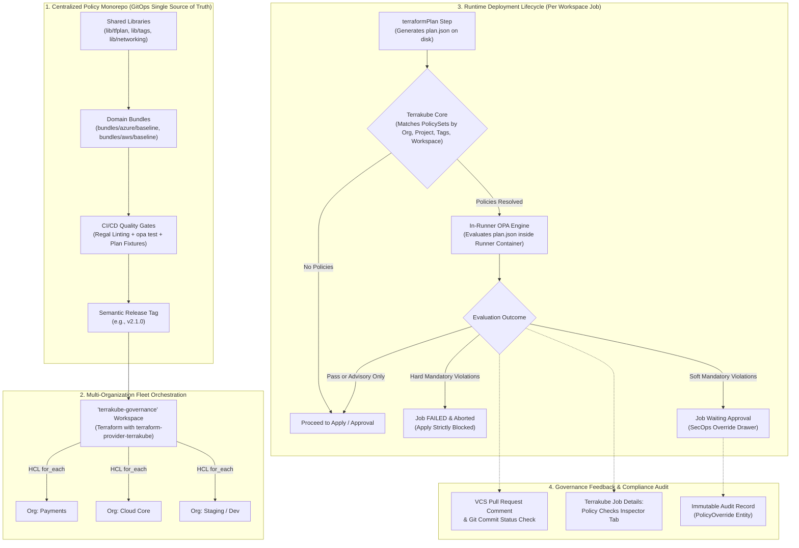
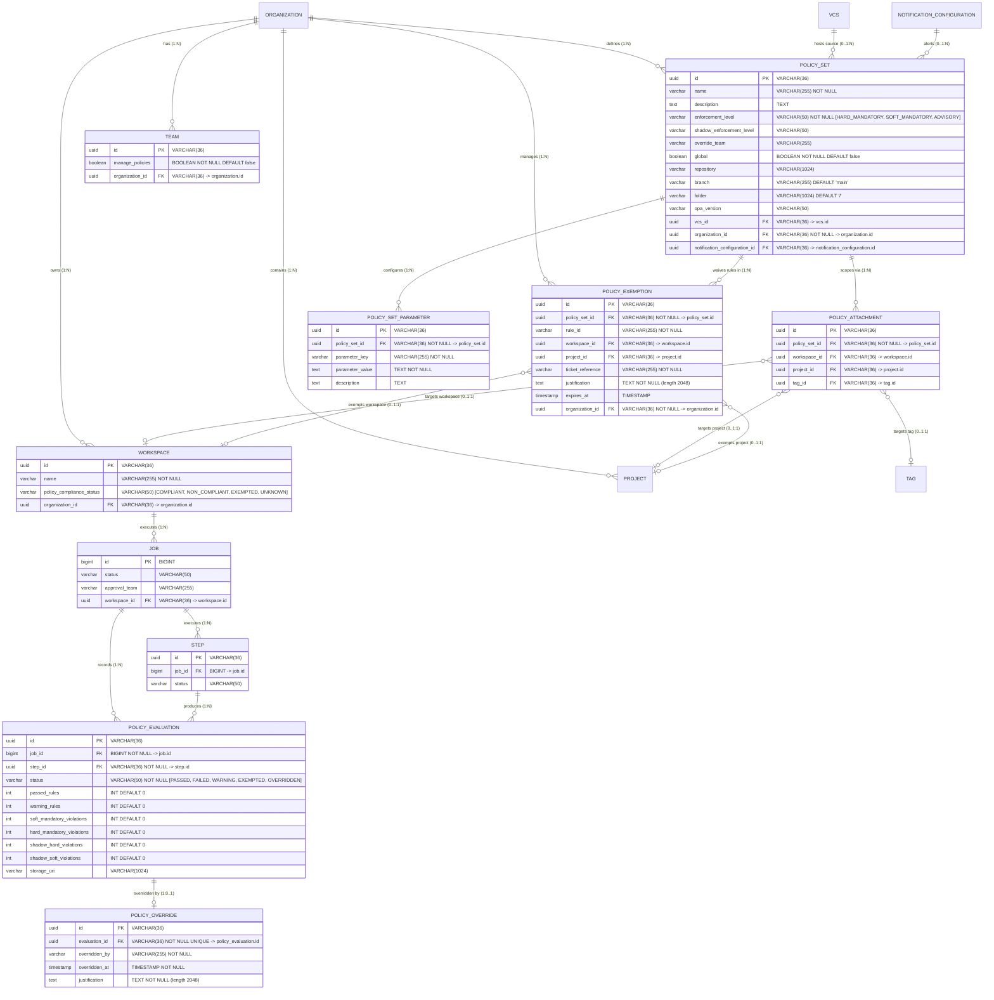
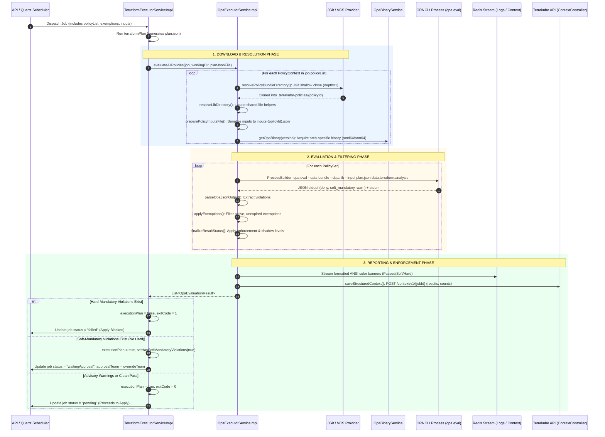
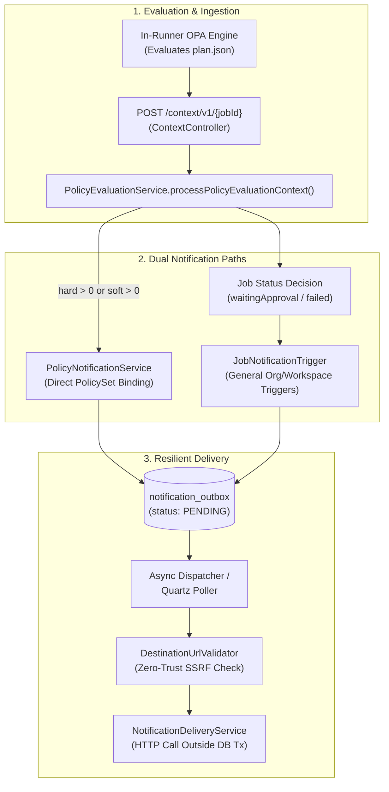

# Terrakube OPA Policy Governance & Fleet Architecture Guide

Terrakube provides centralized Open Policy Agent (OPA) policy governance supporting multi-organization GitOps fleet management, in-runner evaluation against Terraform plan JSON, and three-tier enforcement guardrails.

---

## 1. Architecture Overview



### Core Tenets
1. **Tamper-Proof Governance**: Policies are platform-enforced. Developers cannot delete or bypass policy evaluation by modifying workspace code or workflow template YAML.
2. **Reusability at Scale**: Reusable helper libraries (`lib/`) and modular bundles (`bundles/`) ensure consistent rule enforcement across AWS, Azure, GCP, and Kubernetes without duplicating Rego code.
3. **Infrastructure-as-Code for Policies**: PolicySets and PolicyAttachments are defined and distributed across all Terrakube organizations using Terraform via `terraform-provider-terrakube`.
4. **Safe Phased Rollouts**: Semantic Versioning (`vX.Y.Z`) ensures policy changes are tested in lower environments before being promoted to production organizations.

---

## 2. Domain Models (`io.terrakube.api.rs.policy`)

All policy entities are Yahoo Elide JSON:API resources mapped under `io.terrakube.api.rs.policy`:



* **`PolicySet`** (`@Entity(name = "policy_set")`):
  Defines bundles of Open Policy Agent (Rego) policies linked to a Git VCS repository (`repository`, `branch`, `folder`), optional OPA binary version (`opaVersion`), enforcement level (`enforcementLevel`), optional `shadowEnforcementLevel`, `overrideTeam`, `global` boolean flag, and `notificationConfiguration`. One-to-many with attachments, exemptions, and parameters.
* **`PolicySetParameter`** (`@Entity(name = "policy_set_parameter")`):
  Defines configuration inputs directly on a `PolicySet` (`parameter_key`, `parameter_value`, `description`), injected into in-runner OPA evaluations with JSON-aware typing.
* **`PolicyAttachment`** (`@Entity(name = "policy_attachment")`):
  Scopes a `PolicySet` to a specific `workspace`, `project`, or `tag` (mutually exclusive). Global policy sets do not require attachments.
* **`PolicyExemption`** (`@Entity(name = "policy_exemption")`):
  Provides time-bounded rule waivers for a workspace or project (`ruleId`, `ticketReference`, `justification`, `expiresAt`).
* **`PolicyOverride`** (`@Entity(name = "policy_override")`):
  Immutable audit log created when an authorized SecOps team member approves/overrides a `soft_mandatory` violation.
* **`PolicyEvaluation`** (`@Entity(name = "policy_evaluation")`):
  Historical record of policy execution outcomes, violated rules JSON, and timing metrics.

### Entity & Relational Schema Reference

| Entity | Table | Primary Key | Foreign Keys | Relationship & Scoping Invariants |
| :--- | :--- | :--- | :--- | :--- |
| **`PolicySet`** | `policy_set` | `id` (UUID / VARCHAR 36) | `organization_id` (NOT NULL), `vcs_id`, `notification_configuration_id` | Core policy unit configuring VCS repo, enforcement level, override team, and global flag. One-to-many with attachments, exemptions, and parameters. |
| **`PolicySetParameter`** | `policy_set_parameter` | `id` (UUID / VARCHAR 36) | `policy_set_id` (NOT NULL) | Isolated parameters directly configured on a policy set with JSON-aware runtime typing. |
| **`PolicyAttachment`** | `policy_attachment` | `id` (UUID / VARCHAR 36) | `policy_set_id` (NOT NULL), `workspace_id`, `project_id`, `tag_id` | Scopes non-global policy sets to a specific workspace, project, or tag (mutually exclusive). |
| **`PolicyExemption`** | `policy_exemption` | `id` (UUID / VARCHAR 36) | `policy_set_id` (NOT NULL), `organization_id` (NOT NULL), `workspace_id`, `project_id` | Time-bounded rule waiver for specific workspace or project with mandatory ticket reference and justification. |
| **`PolicyEvaluation`** | `policy_evaluation` | `id` (UUID / VARCHAR 36) | `job_id` (BIGINT NOT NULL), `step_id` (UUID NOT NULL) | Records evaluation results for a specific Terraform plan step (`passed`, `warning`, `soft_mandatory`, `hard_mandatory`, `shadow_*`). 1:1 with `PolicyOverride`. |
| **`PolicyOverride`** | `policy_override` | `id` (UUID / VARCHAR 36) | `evaluation_id` (UUID NOT NULL UNIQUE) | Immutable audit log capturing who approved a `soft_mandatory` violation and when, with required justification. |
| **`Workspace`** | `workspace` | `id` (UUID / VARCHAR 36) | `organization_id`, `project_id` | Augmented with `policy_compliance_status` (`COMPLIANT`, `NON_COMPLIANT`, `EXEMPTED`, `UNKNOWN`). |
| **`Team`** | `team` | `id` (UUID / VARCHAR 36) | `organization_id` | Augmented with `manage_policies` (BOOLEAN NOT NULL DEFAULT false) permission column. |

---

## 3. Policy API & Controller Endpoints

The OPA Policy Governance subsystem exposes two distinct API planes:

### A. Yahoo Elide JSON:API & GraphQL Plane (`/api/v1` & `/graphql/api/v1`)
All declarative governance entities are managed through Elide JSON:API and GraphQL:

| Endpoint Path | Methods | Resource / Entity | Root-Level? | Elide Security Permissions |
| :--- | :--- | :--- | :--- | :--- |
| `/api/v1/policy_set`<br/>`/api/v1/organization/{orgId}/policySet` | `GET`, `POST`, `PATCH`, `DELETE` | `PolicySet` (`policy_set`) | Yes (`@Include`) | Read: `team view policy set`<br/>Mutations: `team manage policy set` |
| `/api/v1/policy_set/{id}/attachments` | `GET`, `POST`, `PATCH`, `DELETE` | `PolicyAttachment` (`policy_attachment`) | No (`@Include(rootLevel = false)`) | Read: `team view policy attachment`<br/>Mutations: `team manage policy attachment` |
| `/api/v1/policy_set/{id}/parameters` | `GET`, `POST`, `PATCH`, `DELETE` | `PolicySetParameter` (`policy_set_parameter`) | No (`@Include(rootLevel = false)`) | Read: `team view policy set parameter`<br/>Mutations: `team manage policy set parameter` |
| `/api/v1/policy_exemption`<br/>`/api/v1/organization/{orgId}/policyExemption`<br/>`/api/v1/policy_set/{id}/exemptions` | `GET`, `POST`, `PATCH`, `DELETE` | `PolicyExemption` (`policy_exemption`) | Yes (`@Include`) | Read: `team view policy exemption`<br/>Mutations: `team manage policy exemption` |
| `/api/v1/job/{jobId}/policyEvaluation`<br/>`/api/v1/step/{stepId}/policyEvaluation` | `GET`<br/>(Mutations via service) | `PolicyEvaluation` (`policy_evaluation`) | No (`@Include(rootLevel = false)`) | Read: `team view policy evaluation`<br/>Mutations: `user is a super service` |
| `/api/v1/job/{jobId}/policyEvaluation/{evalId}/override` | `GET`, `POST` | `PolicyOverride` (`policy_override`) | No (`@Include(rootLevel = false)`) | Read: `team view policy override`<br/>Create: `team override policy`<br/>Update/Delete: `user is a super service` |

* **GraphQL Endpoint**: `/graphql/api/v1` supports native querying, filtering, and mutations for all policy entities.
* **Relationship Traversals on Core Entities**:
  * `Organization`: `/api/v1/organization/{id}/policySet`, `/api/v1/organization/{id}/policyExemption`
  * `NotificationConfiguration`: `/api/v1/notificationConfiguration/{id}/policySet`
  * `Job`: `/api/v1/job/{id}/policyEvaluation`
  * `Step`: `/api/v1/step/{id}/policyEvaluation`

### B. Spring MVC Remote State Plane (`RemoteTfeController.java` under `/remote/tfe/v2`)
Provides TFE CLI and external runner compatibility for runtime policy check evaluation, ANSI log streaming, and SecOps override actions:

| Route & HTTP Method | Request / Response Format | Description & Behavior | RBAC / Authorization |
| :--- | :--- | :--- | :--- |
| `GET /remote/tfe/v2/runs/{runId}/policy-checks` | `application/vnd.api+json`<br/>-> `PolicyCheckList` | Lists all policy check evaluations for a given run (`Job`). Automatically strips `run-` prefix. | Authenticated via JWT `principal`. Validates user access to organization/workspace. |
| `GET /remote/tfe/v2/policy-checks/{id}` | `application/vnd.api+json`<br/>-> `PolicyCheckData` | Retrieves single policy check details, violation counts, and status. Automatically strips `polchk-` prefix or parses raw UUID. Returns 404 if not found. | Authenticated via JWT `principal`. |
| `GET /remote/tfe/v2/policy-checks/{id}/output` | `text/plain` | Streams human-readable ANSI terminal output summarizing passed, advisory, soft-mandatory, and hard-mandatory rules. | Authenticated via JWT `principal`. |
| `POST /remote/tfe/v2/policy-checks/{id}/actions/override` | Consumes optional JSON:<br/>`{ "justification": "..." }`<br/>Returns: `PolicyCheckData` | Submits SecOps policy override for a check with `soft_mandatory` violations. Creates immutable `PolicyOverride` audit record, transitions evaluation status to `OVERRIDDEN` (and check status to `overridden`), and enables run resumption. Rejects checks with `hard_mandatory` violations (HTTP 400). | Checked via `validateUserCanOverridePolicy`: User must be an Org Admin or member of configured `overrideTeam`. |
| `@ExceptionHandler(IllegalArgumentException.class)` | `application/vnd.api+json`<br/>HTTP 400 | Returns standard JSON:API formatted error envelope on malformed IDs or illegal override attempts. | N/A |

---

## 4. Yahoo Elide Security Checks & Permission Grammar

### Strict Constraint: No Underscores Allowed in Elide Expressions
Yahoo Elide's expression tokenizer treats underscore characters (`_`) as unrecognized tokens, failing with:
```text
token recognition error at: '_'
```
**Mandate**: All `@SecurityCheck(RULE)` annotations and Elide permission expressions (`@ReadPermission`, `@CreatePermission`, `@UpdatePermission`, `@DeletePermission`) MUST use space-separated words without underscores:

```java
@Include
@Getter
@Setter
@Entity(name = "policy_set")
@ReadPermission(expression = "team view policy set")
@CreatePermission(expression = "team manage policy set")
@UpdatePermission(expression = "team manage policy set")
@DeletePermission(expression = "team manage policy set")
public class PolicySet extends GenericAuditFields { ... }
```

### Security Checks Implemented (`io.terrakube.api.rs.checks.policy`)
* `TeamViewPolicySet` (`RULE = "team view policy set"`): Allows read access for organization members or users with limited workspace view rights.
* `TeamManagePolicySet` (`RULE = "team manage policy set"`): Enforces admin rights within the owning organization to create, update, or delete policy sets.
* `TeamViewPolicyAttachment` / `TeamManagePolicyAttachment`: Controls attachment RBAC based on organization membership.
* `TeamOverridePolicy` (`RULE = "team override policy"`): Validates that the user belongs to the `overrideTeam` configured on the violated policy set or possesses organization admin credentials.

---

## 5. Policy Resolution Lifecycle & Non-Transactional Invariants

### 4-Tier Cumulative Resolution (`PolicyResolutionService`)
When Terrakube dispatches a job, `PolicyResolutionService.resolvePoliciesForJob(Job job)` computes the cumulative set of applicable policies in hierarchical order:

1. **Global Baseline**: `policySetRepository.findByOrganizationAndGlobalTrue(org)`
2. **Project-Scoped**: `policyAttachmentRepository.findByProject(project)`
3. **Tag-Scoped**: `workspaceTagRepository.findByWorkspace(workspace)` -> `tagRepository.findAllById(tagUuids)` -> `policyAttachmentRepository.findByTagIn(tags)`
4. **Workspace-Scoped**: `policyAttachmentRepository.findByWorkspace(workspace)`

All policy sets are deduplicated by `PolicySet.id` and sorted alphabetically by name.

### Policy Set Parameters (`PolicySetParameter`) & Ingestion
Parameters are configured directly at the `PolicySet` level (via the Web UI or API) and strictly isolated per policy set during execution:
* **Storage**: Saved as `PolicySetParameter` records linked to the specific `PolicySet`.
* **Strict Isolation**: Each policy set receives only its own configured parameters in `PolicyContext.inputs`. Parameters do not leak across policy sets, and ambient organization/workspace variables are not merged.
* **JSON-Aware Typing**: In runner evaluation (`OpaExecutorServiceImpl.preparePolicyInputsFile`), parameter values are parsed with JSON awareness:
  * Numbers (e.g. `5` -> integer/float)
  * Booleans (e.g. `true` / `false`)
  * JSON Arrays (e.g. `["us-east-1", "us-west-2"]` -> list)
  * JSON Objects (e.g. `{"timeout": 30, "retries": 3}` -> dictionary)
  * Plain text strings remain strings.
* **OPA Injection**: Written to `.terrakube-policies/inputs-{policyId}.json` under `{"terrakube": {"inputs": { ... }}}` and passed via `--data`.
* **Rego Usage**: Policies access parameters directly through `data.terrakube.inputs.<key>`.

### Critical Quartz Job Invariant: Avoid Lazy Loading Outside Sessions
In Terrakube, `ScheduleJob.doRunExecution` intentionally runs without a surrounding Hibernate transaction so individual repository operations commit independently and the Redis `ExecutionLease` (`job-execution-lock:<jobId>`) is renewed and released cleanly.

> [!CAUTION]
> **Never Access `@OneToMany` Lazy Collections on Detached Entities in Background Jobs**:
> Calling `job.getWorkspace().getWorkspaceTag()` outside an open session throws:
> `org.hibernate.LazyInitializationException: Cannot lazily initialize collection of role 'io.terrakube.api.rs.workspace.Workspace.workspaceTag' (no session)`.
>
> **Solution**: Always query dedicated Spring Data JPA repositories:
> ```java
> List<WorkspaceTag> workspaceTags = workspaceTagRepository.findByWorkspace(job.getWorkspace());
> ```

---

## 6. Enforcement Levels & Execution Engine

### In-Runner Execution Lifecycle (Download, Evaluate, Report)

OPA evaluations run in-runner inside the executor (both Kubernetes ephemeral containers and persistent runner processes) on `plan.json` immediately following `terraformPlan`:



### Policy Types & Categories Taxonomy

| Dimension | Type / Category | Purpose & Operational Behavior | Typical Use Cases |
| :--- | :--- | :--- | :--- |
| **Enforcement Level**<br/>(`PolicyEnforcementLevel` enum) | **`hard_mandatory`** | **Strict Blocker**: Fails the run immediately (`exitCode = 1`), transitions job to `failed`, and strictly halts Apply. Cannot be overridden. | Non-negotiable security (unencrypted storage, 0.0.0.0/0 ingress), compliance mandates. |
| | **`soft_mandatory`** | **Gated with Override**: Pauses workflow into `waitingApproval`, requires an authorized SecOps team member to submit justification before Apply is unblocked. | Blast radius thresholds, production deployment timing, cross-region infrastructure changes. |
| | **`advisory`** | **Informational Warning**: Emits ANSI yellow warnings and PR comments but never blocks plan or apply. Runs proceed automatically. | Deprecation notices, naming convention suggestions, non-critical hygiene recommendations. |
| **Scoping Hierarchy** | **Global Baseline** | Fleet-wide coverage across all workspaces in the organization (`global = true`). | Base tagging, security hygiene, common blast radius limits. |
| | **Project-Scoped** | Scoped to all workspaces within a business project (`PolicyAttachment.project`). | Departmental policies (e.g. Payments, Data Engineering). |
| | **Tag-Scoped** | Dynamically targeted to workspaces carrying specific tags (`PolicyAttachment.tag`). | Cloud-specific policies (`cloud:azure`), tier policies (`env:prod`). |
| | **Workspace-Scoped** | Explicitly pinned to a single workspace (`PolicyAttachment.workspace`). | Workspace-specific architectural exceptions or unique requirements. |

> [!NOTE]
> **Passive Shadow Evaluation (`shadow_enforcement_level`)**:
> `shadow` is **not** a distinct enum value in `PolicyEnforcementLevel`. Instead, `shadowEnforcementLevel` is an optional entity field on `PolicySet` (`PolicySet.java:L58`) accepting `HARD_MANDATORY` or `SOFT_MANDATORY`. When populated, the executor passively evaluates rules in shadow mode and records informational violation counts (`shadowHardViolations`, `shadowSoftViolations`) without altering the job outcome or blocking execution.

### Soft-Mandatory Approval & Suspension Lifecycle

When a Terraform plan produces soft-mandatory violations without hard-mandatory violations, Terrakube suspends the workflow before `terraformApply`:

```mermaid
sequenceDiagram
    autonumber
    participant Runner as Executor (TerraformExecutorServiceImpl)
    participant OPA as OpaExecutorServiceImpl
    participant Context as JobContextService
    participant Status as UpdateJobStatusImpl
    participant API as Terrakube API (Job Entity)
    participant Quartz as Quartz Scheduler (ScheduleJob)
    participant UI as Terrakube UI (Jobs/Details)

    Runner->>OPA: evaluateAllPolicies(job, plan.json)
    OPA-->>Runner: List<OpaEvaluationResult> (soft > 0, hard == 0)
    OPA->>Context: saveContext("policyEvaluation", payload with aggregate counts)
    Runner->>Runner: Resolve overrideTeam from matching PolicyContext
    Runner->>Status: setCompletedStatus(..., hasSoftMandatoryViolations=true, approvalTeam=overrideTeam)
    Status->>API: updateJob(status="waitingApproval", approvalTeam=overrideTeam)
    Status-->>Quartz: Job status is "waitingApproval"
    Note over Quartz: Quartz ScheduleJob halts dispatch;<br/>terraformApply is NOT scheduled.
    UI->>Context: Fetch /context/v1/{jobId}
    Note over UI: UI displays "Action Required" tag and<br/>"Someone from {approvalTeam} must confirm"
    UI->>API: Override or Approve Job (status="approved")
    Quartz->>API: executeApprovedJobs() dispatches terraformApply
```

#### 1. In-Runner Evaluation & Team Resolution (`TerraformExecutorServiceImpl`)
* After `opaExecutorService.evaluateAllPolicies(...)`:
  - `hasHardViolations`: If any result has `hardMandatoryViolations > 0`, the run fails immediately (`executionPlan = false`, `exitCode = 1`).
  - `hasSoftViolations`: If `softMandatoryViolations > 0` and no hard violations exist, the plan remains valid (`executionPlan = true`), but requires approval.
  - The executor searches `terraformJob.getPolicyList()` for the violated policy set ID to extract its configured `overrideTeam`.
  - Propagates `result.setHasSoftMandatoryViolations(true)` and `result.setApprovalTeam(overrideTeam)`.

#### 2. Structured Context Aggregation (`OpaExecutorServiceImpl`)
* In `saveStructuredContext`, the executor aggregates rule counts across all evaluated policy sets:
  - `softMandatoryViolations`, `hardMandatoryViolations`, `passedRules`, `warningRules`, `shadowHardViolations`, `shadowSoftViolations`.
  - Overall status: `FAILED` (if hard > 0), `WAITING_APPROVAL` (if soft > 0), `WARNING` (if warnings > 0), or `PASSED`.
* Persisted to Redis/MinIO via `JobContextService` under the key `policyEvaluation`.
* The UI (`Details.tsx`) inspects `policyEvaluation.softMandatoryViolations > 0` to render the yellow `"Action Required"` badge and present the approval banner.

#### 3. Job Status Suspension (`UpdateJobStatusImpl`)
* When `isPlan` is true and `hasSoftMandatoryViolations` is set on a successful plan (`exitCode != 1`):
  - Sets `job.status = "waitingApproval"`.
  - Sets `job.approvalTeam = approvalTeam` (e.g., `"SecOps"`).
* Quartz's `ScheduleJob.doRunExecution` checks the job status. Because the status is `"waitingApproval"` rather than `"pending"`, the job falls into the default handler and the next step (`terraformApply`) is **not** scheduled.

#### 4. Approval & Resumption
* **Approval Actions**:
  - Authorized team members can submit a policy override via the UI drawer (`POST /remote/tfe/v2/policy-checks/{id}/actions/override`) with a mandatory justification.
  - Organization admins or members of `approvalTeam` approve the job (setting `status = "approved"`).
* **Resumption**:
  - Quartz detects `job.status == "approved"` and invokes `executeApprovedJobs(job)`, which transitions the job back to `pending` and dispatches `terraformApply`.

### VCS Feedback, Notifications & PR Comments
* `PrCommentService.renderPolicyGuardrailsSummary()` posts rich Markdown summaries to GitHub/GitLab pull requests:
  * Null-safe violation rendering (`hasNonNull()` checks, falling back to `policySetId` when `policySetName` is absent, normalizing `SOFT_MANDATORY` -> `soft-mandatory`).
  * Status headers: `FAILED`, `FAILED (SOFT-MANDATORY)`, `PASSED (OVERRIDDEN)`, `PASSED (WITH EXEMPTION)`, `PASSED (WITH WARNINGS)`, or `PASSED`.
  * Pull request commit status check updated (`pending`, `success`, `failure`).
* `PolicyNotificationService` builds `workspaceUrl`/`runUrl` from `io.terrakube.ui.url` and dispatches policy alerts using `NotificationMessageStyle.DETAILED`.

---

## 7. Policy Exemption Architecture & Runner Evaluation Lifecycle

Terrakube supports time-bounded and permanent compliance waivers (**Policy Exemptions**) that permit specific Rego rule violations to be bypassed without disabling the entire policy set or halting CI/CD runs.

### 1. Domain Model & Scoping Hierarchy
Policy exemptions are modeled via `PolicyExemption` (`@Entity(name = "policy_exemption")`):
* **Scoping Levels**:
  * **Organization-Wide**: `workspace == null && project == null` — Waives rule across all workspaces and projects in the organization.
  * **Project-Scoped**: `project != null && workspace == null` — Inherited by all workspaces belonging to the targeted project.
  * **Workspace-Scoped**: `workspace != null` — Applies exclusively to the targeted workspace.
* **Fields**:
  * `ruleId`: Target Rego rule identifier evaluated by OPA (e.g. `aws_s3_bucket_no_public_access`).
  * `ticketReference`: Audited issue tracker or change ticket reference (e.g. `SEC-8842` or Jira link).
  * `justification`: Detailed explanation of why the compliance exception was granted (up to 2048 chars).
  * `expiresAt`: Optional expiration date & time. If `null`, the waiver is permanent/indefinite.
  * `policySet`: Associated `PolicySet` containing the rule.

### 2. Permissions & Security Invariants
* **Governance Permission**: Governed by `team.manage_policies` (`rbacService.canManagePolicies(team)`).
* **Authorized Roles**: Organization Admins (`ROLE_ADMIN`), Custom Roles with `managePolicies = true`, and `instanceOwner`.
* **Elide Security Check Expressions**:
  * Read: `@ReadPermission(expression = "team view policy exemption")`
  * Mutations: `@CreatePermission / @UpdatePermission / @DeletePermission(expression = "team manage policy exemption")`
* **Token Controller Endpoints**: `TeamTokenController` exposes `managePolicies` in `PermissionSet` across both `/permissions/organization/{organizationId}` and `/permissions/organization/{organizationId}/workspace/{workspaceId}`.

### 3. API Resolution Phase (`PolicyResolutionService`)
During job dispatch or headless evaluation, `ExecutorService` invokes:
```java
public List<PolicyExemptionContext> resolveExemptionsForJob(Job job)
```
1. Active exemptions are retrieved via `PolicyExemptionRepository.findActiveExemptionsForWorkspace`:
   ```sql
   SELECT pe FROM policy_exemption pe WHERE pe.organization = :org
     AND (pe.expiresAt IS NULL OR pe.expiresAt > :now)
     AND (pe.workspace = :workspace
          OR (pe.project IS NOT NULL AND pe.project = :project)
          OR (pe.workspace IS NULL AND pe.project IS NULL))
   ```
2. Resulting entities are mapped to immutable `PolicyExemptionContext` DTOs containing `exemptionId`, `policySetId`, `ruleId`, `ticketReference`, `justification`, and `expiresAt`.
3. Attached to `ExecutorContext.policyExemptionList` and serialized into the `TerraformJob` payload.

### 4. Runner Evaluation & In-Runner Filtering (`OpaExecutorServiceImpl`)
During in-runner policy execution in `OpaExecutorServiceImpl`:
1. **Raw Evaluation**: OPA evaluates `plan.json` against policy bundles and produces raw violations in `OpaEvaluationResult.getViolations()`.
2. **Filtering via `applyExemptions()`**:
   Matches violations against the job's `exemptions` list where:
   * `e.getPolicySetId().equals(policySetId)`
   * `e.getRuleId().equals(violation.getRuleId())`
   * Defense-in-depth unexpired check: `e.getExpiresAt() == null || e.getExpiresAt().after(now)`
3. **Bypassing Violation**:
   * Removed from `result.getViolations()`.
   * Violation status updated to `ViolationStatus.EXEMPTED`.
   * Audit metadata (`ticketReference`, `justification`, `expiresAt`) attached.
   * Added to `result.getExemptedViolations()`.
   * Emits ANSI audit log:
     ```text
     [EXEMPTED] Rule '<ruleId>' bypassed on '<address>' (Ticket: <ticket>, Expires: <date|Indefinite>)
     ```
4. **Finalization (`finalizeResultStatus`)**:
   * Hard and soft mandatory counts are calculated **only** from the remaining violations in `result.getViolations()`.
   * If all blocking violations are bypassed, the policy set passes.
   * If any violations were exempted, the runner prints an audit summary banner:
     ```text
     🛡️ [EXEMPTIONS ACTIVE] N rule violation(s) bypassed via approved active exemptions.
     ```
   * VCS PR comment reflects status: `PASSED (WITH EXEMPTION)`.

### 5. Web Console Management (`ui`)
* **Organization Settings** (`/organizations/:orgid/settings/policies?tab=exemptions`):
  * Filter bar supporting text search, status dropdown (`All`, `Active`, `Expiring Soon`, `Expired`, `Permanent`) with count badges, scope dropdown, and policy set dropdown.
  * Tabular display with copyable rule IDs, policy set tags, scope badges, ticket references, expiration badges, and Edit / Revoke actions.
* **Workspace Settings** (`/organizations/:orgid/workspaces/:id/settings/policies`):
  * Displays active exemptions applying to the workspace (distinguishing local vs inherited org/project waivers).
  * "+ Add Exemption" button pre-locked to the current workspace.
* **Run Violation Inspector** (`PolicyChecksOutput.tsx`):
  * "Add Exemption" shortcut on violation rows (`hard_mandatory` or `soft_mandatory`), pre-filling rule ID, policy set, and workspace.
  * Success prompt offers immediate "Evaluate Policies Now" action to re-run headless evaluation without triggering a full pipeline.
* **Modal UX Standards**:
  * Permanent / Indefinite exemption toggle backed by React state + Ant Design `Form.Item(valuePropName="checked")` with clickable label text.
  * Quick expiration duration presets: `+30 Days`, `+60 Days`, `+90 Days`, `+1 Year`.

---

## 8. Terraform Provider Conventions (`terraform-provider-terrakube`)

### Collection Endpoint Naming
Because Elide entities use `@Entity(name = "policy_set")`, Elide exposes them under snake_case endpoints. Provider HTTP client calls must match:
* Correct: `/api/v1/policy_set/{id}/attachments`
* Incorrect: `/api/v1/policySet/{id}/attachments` (causes 404 `Unknown collection policySet`)

### Resource Definitions
* `terrakube_policy_set`:
  ```terraform
  resource "terrakube_policy_set" "blast_radius" {
    organization_id   = data.terrakube_organization.org.id
    name              = "common-blast-radius"
    description       = "Soft mandatory guardrail requiring SecOps override"
    enforcement_level = "soft_mandatory"
    override_team     = "secops"
    vcs_id            = var.vcs_id
    repository        = var.policy_repo
    branch            = "main"
    folder            = "bundles/common/blast_radius" # Note: attribute is folder, NOT path
  }
  ```
* `terrakube_policy_attachment`:
  ```terraform
  resource "terrakube_policy_attachment" "example" {
    policy_set_id = terrakube_policy_set.blast_radius.id
    workspace_id  = terrakube_workspace_cli.compliant.id # Or project_id, or tag_id
  }
  ```
* `terrakube_workspace_cli`:
  Requires `execution_mode`, `iac_type`, and `iac_version`.

### Local Provider Development Override
When validating unreleased provider features locally:
```hcl
# ~/.terraformrc
provider_installation {
  dev_overrides {
    "terrakube-io/terrakube" = "<path-to-go-bin>"
  }
  direct {}
}
```
Compile provider using `go build -v -o <path-to-go-bin>/terraform-provider-terrakube .`.

---

## 9. Testing & Verification

1. **Policy Bundles**:
   Validate Rego rules with Regal and `opa test`:
   ```bash
   opa test lib/ bundles/ -v
   ```
2. **Backend API**:
   Verify cumulative policy resolution and scheduler non-transactional safety:
   ```bash
   mvn test -Dtest="PolicyResolutionServiceTest,ScheduleJobTest,PolicyEvaluationServiceTest" -pl api
   ```
3. **Fleet Terraform Testing**:
   Run `terraform plan` and `terraform apply` in `terrakube-governance` to provision workspaces, policy sets, and attachments.

---

## 10. Continuous Compliance & Maintenance Schedulers (Drift & Retention)

Terrakube provides two specialized Quartz background jobs to maintain continuous workspace compliance and database audit health:

### 1. Policy Drift Evaluation (`PolicyDriftEvaluationJob`)
* **Purpose**: Detects policy compliance drift across all workspaces when policies are updated, new policy sets are attached, or exemptions expire, without requiring developers to push code or manually trigger a run.
* **Schedule**: Configured via `io.terrakube.policy.drift.cron` (default: `0 0 2 * * ?` -> 2:00 AM daily).
* **Stability, Memory & Queue Protection Architecture**:
  1. **Paginated Database Scanning (`PageRequest`)**:
     - Uses chunked repository queries (`workspaceRepository.findAll(PageRequest.of(pageNumber, batchSize))`, default `batchSize=50`).
     - Eliminates JVM heap spikes across installations with thousands of workspaces compared to unpaged `findAll()`.
  2. **Active Concurrency Window (Backpressure Gate)**:
     - Quartz operates on a small thread pool (default 8 worker threads: `io.terrakube.scheduler.thread-count: 8`). Because each dispatched job registers a 30-second recurring Quartz trigger (`ScheduleJob`), flooding the queue with drift jobs saturates the pool and starves notification outbox dispatchers, webhook deliveries, and user runs.
     - Tracks active drift jobs via `jobRepository.countByViaAndStatusIn("Drift", List.of(pending, queue, running))`.
     - Strictly caps in-flight drift jobs to `maxActiveJobs` (default: `5`). When the ceiling is reached, scanning halts immediately to release the Quartz thread.
  3. **Stateless Workspace Skipping & Cooldown**:
     - **Active Run Skip**: Workspaces with any non-terminal active job (`jobRepository.findActiveJobIdsByWorkspace`) are skipped to prevent workspace queue blockages.
     - **Drift Cooldown**: Workspaces whose latest run was a drift evaluation within `cooldownHours` (default: `12` hours) are skipped. This ensures multi-stage follow-up runs only evaluate uninspected workspaces without requiring stateful database cursor tracking.
  4. **Self-Scheduled Follow-Up Trigger**:
     - When the concurrency ceiling (`maxActiveJobs`) or batch limit (`maxJobsPerRun`, default: `100`) is hit and uninspected workspaces remain, the job automatically schedules a one-off Quartz follow-up trigger (`TerrakubeV2_PolicyDriftEvaluation_FollowUp`) to run in `followUpDelayMinutes` (default: `2` minutes) via `context.getScheduler()`.
     - This resumes progress once active jobs finish without blocking or sleeping within the Quartz worker thread.
  5. **Workspace Filtering & Applicability**:
     - Skips workspaces that are `deleted`, `locked`, or have status `NeverExecuted`.
     - Retrieves the latest completed run with a valid `terraformPlan` URL (`findFirstByWorkspaceAndAndStatusInOrderByIdDesc`). If no completed plan exists, the workspace is safely skipped.
     - Resolves applicable policies using `PolicyResolutionService`. If no policies match, the workspace is skipped.
* **Headless TCL Execution Flow**:
  - Dispatches a lightweight job with `FlowType.policyEvaluation` tagged with `via="Drift"`:
    ```yaml
    flow:
      - type: policyEvaluation
        step: 100
        name: OPA Policy Drift Evaluation
    ```
  - **Executor Optimization**: In `SetupWorkspaceImpl`, the executor detects `"policyEvaluation"` and **bypasses workspace git clone and tarball download**.
  - `OpaExecutorServiceImpl.evaluateJob()` downloads `plan.json` directly from storage and evaluates all policy sets against it.
  - Updates `Workspace.policyComplianceStatus` (`COMPLIANT`, `NON_COMPLIANT`, `EXEMPTED`) and records `PolicyEvaluation` entries without altering live workspace state.

### 2. Audit Retention & Storage Pruning (`PolicyEvaluationRetentionJob`)
* **Purpose**: Enforces enterprise data retention policies and prevents unbounded database and object storage growth from daily drift evaluations and historical plan runs.
* **Storage Offload Lifecycle**:
  - **Offload on Evaluation**: When a job evaluation completes, `PolicyEvaluationService` offloads the verbose violation details (`evalNode.get("results")`) to object storage via `storageTypeService.uploadPolicyEvaluation(storageUri, resultsJson)` at `policy-evaluations/<jobId>/violations.json`.
  - **Metadata in PostgreSQL**: The `policy_evaluation` relational entity only stores summary integer metrics (`passed_rules`, `warning_rules`, `soft_mandatory_violations`, `hard_mandatory_violations`, `shadow_*`), status, and a pointer `storage_uri`.
  - **Storage Deletion Requirement**: Because `storage_uri` points to external cloud/local object storage (AWS S3, Azure Blob, GCP Storage, Local filesystem), database-only deletions leave orphaned objects accumulating in storage buckets indefinitely.
* **Schedule**: Configured via `io.terrakube.policy.evaluation.retentionCron` (default: `0 0 4 * * ?` -> 4:00 AM daily).
* **Retention Window**: Configured via `io.terrakube.policy.evaluation.retentionDays` (default: `90` days).
* **Execution & Cascade Order**:
  1. Computes cutoff timestamp: `cutoff = new Date(System.currentTimeMillis() - retentionMillis)`.
  2. **Storage Object Pruning**:
     - Queries distinct storage URIs for evaluations created before cutoff:
       `policyEvaluationRepository.findStorageUrisByCreatedDateBefore(cutoff)`
     - Iterates through the list and invokes `storageTypeService.deletePolicyEvaluation(uri)` to delete the file from object storage (S3 bucket, Azure container, GCP bucket, or local disk).
     - Individual deletions are isolated in `try-catch` blocks: failure to delete one remote file logs a warning and does not abort remaining file deletions or database record pruning.
  3. **Child Database Pruning**: Deletes dependent override records:
     `policyOverrideRepository.deleteByCreatedDateBefore(cutoff)`.
  4. **Parent Database Pruning**: Deletes evaluation records:
     `policyEvaluationRepository.deleteByCreatedDateBefore(cutoff)`.
  5. **Concurrency Protection**: Annotated with `@DisallowConcurrentExecution` so multiple Quartz worker threads never run overlapping sweeps.

### Configuration Properties Reference

| Property | Environment Variable | Default Value | Description |
| :--- | :--- | :--- | :--- |
| `io.terrakube.policy.drift.cron` | `PolicyDriftCron` | `0 0 2 * * ?` | Cron expression for the nightly policy drift evaluation sweep. |
| `io.terrakube.policy.drift.batchSize` | `PolicyDriftBatchSize` | `50` | Page size for paginated workspace database queries. |
| `io.terrakube.policy.drift.maxJobsPerRun` | `PolicyDriftMaxJobsPerRun` | `100` | Maximum number of drift evaluation jobs dispatched per execution run. |
| `io.terrakube.policy.drift.maxActiveJobs` | `PolicyDriftMaxActiveJobs` | `5` | Concurrency ceiling for in-flight drift jobs (`pending`, `queue`, `running`) to prevent Quartz thread saturation. |
| `io.terrakube.policy.drift.followUpDelayMinutes` | `PolicyDriftFollowUpDelayMinutes` | `2` | Delay in minutes before scheduling a follow-up trigger when concurrency limit is hit with remaining workspaces. |
| `io.terrakube.policy.drift.cooldownHours` | `PolicyDriftCooldownHours` | `12` | Cooldown period during which a workspace with a recent drift run is skipped. |
| `io.terrakube.policy.evaluation.retentionCron` | `PolicyEvaluationRetentionCron` | `0 0 4 * * ?` | Cron expression for the nightly policy evaluation retention cleanup sweep. |
| `io.terrakube.policy.evaluation.retentionDays` | `PolicyEvaluationRetentionDays` | `90` | Number of days to retain historical `PolicyEvaluation` and `PolicyOverride` records. |
| `io.terrakube.executor.opa.concurrency.core` | `ExecutorOpaConcurrencyCore` | `8` | Core thread pool size for in-runner parallel OPA policy evaluation. |
| `io.terrakube.executor.opa.concurrency.max` | `ExecutorOpaConcurrencyMax` | `16` | Maximum thread pool size for in-runner parallel OPA policy evaluation. |

---

## 11. OPA Violation Notifications & Transactional Outbox Integration

Terrakube integrates OPA Policy Governance with the Notification engine across two distinct operational planes:



### 1. Dual Notification Pathways
1. **Direct PolicySet Binding (Micro / Compliance Alerts)**:
   * `PolicySet` holds `@ManyToOne @JoinColumn(name = "notification_configuration_id") private NotificationConfiguration notificationConfiguration`.
   * Enables dedicated routing of specific compliance bundles (e.g., PCI-DSS, security guardrails) directly to designated channels (e.g. `#secops-compliance` or security SIEM webhooks) independent of workspace-level notification settings.
2. **Workflow State Orchestration (Macro / Job Lifecycle Alerts)**:
   * Soft-mandatory violations pause the job in `JobStatus.waitingApproval` and assign `job.approvalTeam = overrideTeam`.
   * Hard-mandatory violations abort the job into `JobStatus.failed`.
   * Triggers general organization and workspace notification configurations subscribed to `waitingApproval` or `failed`.

### 2. Processing Pipeline (`PolicyEvaluationService` -> `PolicyNotificationService`)
1. In `ContextController.saveContext`, the uploaded payload triggers `PolicyEvaluationService.processPolicyEvaluationContext(jobId, sanitizedContext)`.
2. When `softViolations > 0` or `hardViolations > 0`, the service queries applicable policy sets and invokes `PolicyNotificationService.sendPolicyViolationNotification(job, orgPolicySets, reason)`.
3. `PolicyNotificationService`:
   * Identifies policy sets with an active `NotificationConfiguration`.
   * Assembles `NotificationContext` with run URL, workspace URL, commit ID, job status, and violation summary reason.
   * Renders the message payload via `NotificationPayloadRenderer` (Slack Block Kit, Teams Adaptive Cards, or Webhook JSON).
   * Inserts an outbox row into `notification_outbox` with `status = PENDING`.

### 3. Drift Compliance Notifications
* Nightly `PolicyDriftEvaluationJob` re-evaluates historical `plan.json` files against updated policies and expiring exemptions without user commits.
* Headless execution posts back to `ContextController`, automatically updating workspace compliance status and dispatching policy violation notifications if drift occurs.

### 4. Transactional Outbox Invariants
* Delivery HTTP requests execute outside DB transactions to prevent connection pool exhaustion.
* All destination URLs undergo SSRF validation via `DestinationUrlValidator` before transmission.

