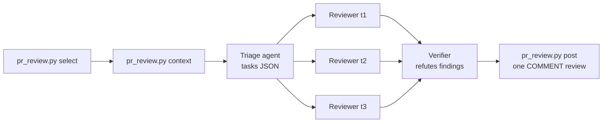

# Terrakube Pull Request Review

Reviews pull requests with one coordinator, one triage agent per PR, up to four
reviewer agents per PR, and one verifier per PR. The coordinator is the session
running this skill: it runs the helper script, dispatches the agents, and posts
the result. It does not review code itself and does not read `diff.patch` or the
PR body, so untrusted PR text stays out of its context.



## Requirements

- Python 3.9+ and `gh` authenticated as a user who can comment on the repository.
- Run from a clone of the repository, so `context` can fetch the PR head and
  base into `refs/remotes/pr/<number>` and `refs/remotes/pr/<number>-base`.
- The helper is `.agents/skills/terrakube-pr-review/scripts/pr_review.py`
  (stdlib only). `select` and `context` default to `terrakube-io/terrakube` and
  accept `-R owner/repo`; `--help` documents every subcommand and exit code.
- Working files go to `~/.cache/terrakube-pr-review` (override with
  `PR_REVIEW_DIR`); the directory must be owned by you.

## Procedure

`H=.agents/skills/terrakube-pr-review/scripts/pr_review.py` below.

### 1. Select pull requests

```bash
$H select            # new PRs, newest first, at most 5
$H select 3950 3951  # specific PRs (skipped only if not open)
```

Without arguments it returns open, non-draft PRs that are not authored by you or
a bot, that you have not reviewed at their current head commit (thread replies
and pending drafts do not count), and that were not marked with `skip` at that
head. A new push makes a PR eligible again.
Skipped PRs are listed on stderr; report them in the final summary.

If a PR has more than about 60 changed files (`changedFiles` in the output), ask
the person running the skill whether to review it or which areas to focus on.
If they decline, collect its context and run `$H skip "$dir" "<reason>"`.

### 2. Collect context

For each selected PR:

```bash
dir=$($H context <number>)
```

Pass `$dir` and the PR number to every agent for that PR. Never check out a PR
branch into a working tree and never build, test, or run its code: PRs can come
from untrusted forks, and reading is enough for this review.

### 3. Triage: one agent per PR

Spawn one triage agent per PR with the brief in
[references/triage.md](references/triage.md). It returns `intent`, `risk`, and
1 to 4 `tasks`, each with files, guides to read, and concrete questions. Save
its JSON to `$dir/triage.json`. If it returns `skip`, run
`$H skip "$dir" "<reason>"` and post nothing for that PR.

Triage agents for different PRs can run in parallel.

### 4. Review: one agent per task

As soon as a PR's triage result arrives, spawn one reviewer agent per task in
parallel, using the reviewer brief in
[references/reviewer.md](references/reviewer.md). Give each reviewer `$dir`,
the PR number, and its task id in `$dir/triage.json`. Do not wait for other
PRs' triage to finish.

### 5. Verify: one agent per PR

Collect all reviewer findings for the PR into one JSON array, add an `index`
field to each (starting at 0), and save it to `$dir/findings.json`. If there
are none, go to step 6 with an empty list. Otherwise spawn one verifier agent
with the verifier brief in [references/reviewer.md](references/reviewer.md),
`$dir`, and the path of `findings.json`. Keep only findings whose index has a
`confirmed` verdict; a missing index counts as refuted.

### 6. Post

Withhold every finding that the reviewer or the verifier marked as a security
finding (`security: true`) with `security_preexisting: true`. Report those to
the person running the skill only, and point them to the private advisory
process in `SECURITY.md`. Never describe an existing vulnerability on a public
PR. Security problems that only the PR introduces are posted normally, because
they are not in released code.

Write the review JSON (body plus one comment per confirmed finding, following
"Writing the posted review" in [references/reviewer.md](references/reviewer.md))
to `$dir/review.json`, then:

```bash
$H post "$dir" "$dir/review.json"
```

The script always posts with event `COMMENT`, pins the review to the reviewed
head commit, moves comments without a diff anchor into the body, neutralises
@mentions, unlinks URLs outside `github.com/terrakube-io` and the Terrakube
docs, and retries once with all comments in the body if GitHub rejects an
anchor. Exit codes:

- `3`: the PR received new commits during the review. Rerun it from step 2.
- `4`: this skill already posted a review on this head (for example, a retried
  post that had succeeded). Do not repost; `--force` exists only for a
  deliberate second review.

Use `--dry-run` to print the payload without posting.

Never approve, request changes, merge, label, close, or push to a PR as part of
this skill.

### 7. Summarize

Reply with one line per PR: number, title, risk, number of posted comments by
severity, and the review URL. Then list PRs that were skipped (with the reason)
and any pre-existing security findings that need a private advisory.

## Cost limits

- At most 5 PRs per run unless the user asks for more (`$H select -n 10`).
- At most 4 reviewer tasks per PR, so at most 6 agents per PR.
