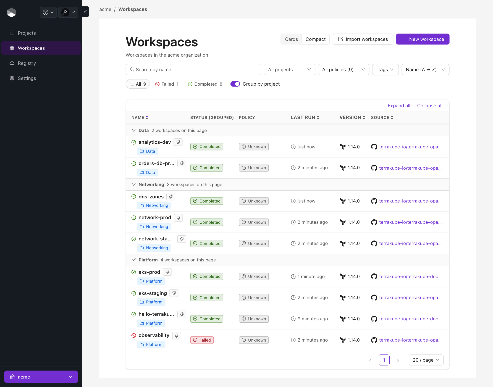
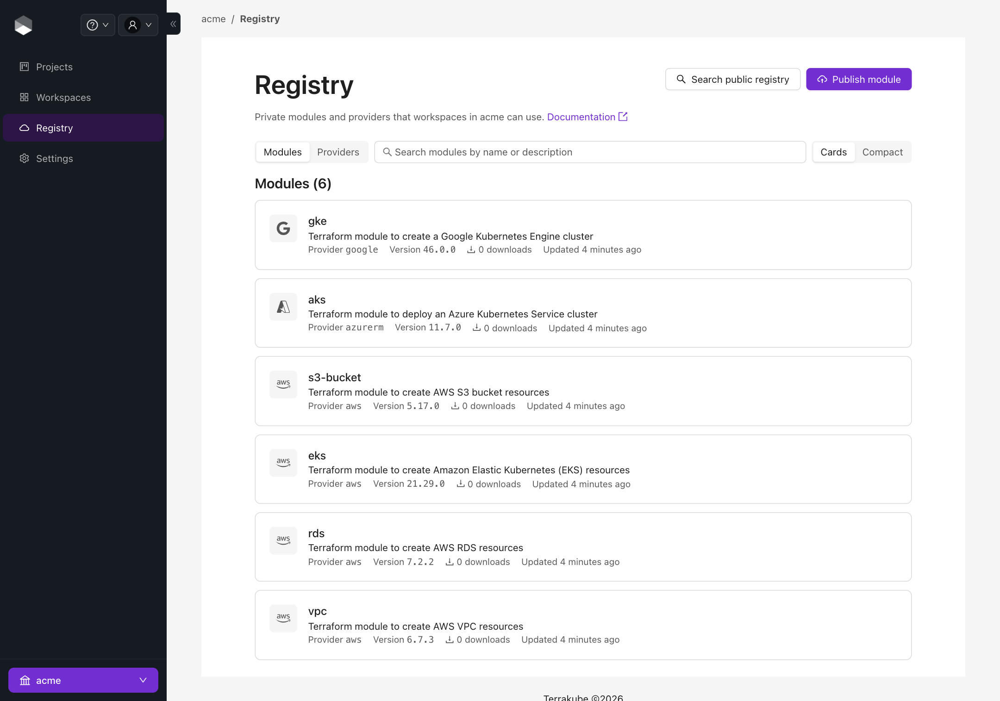
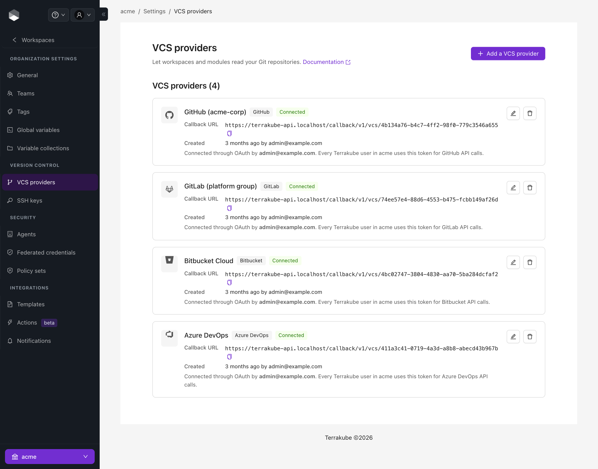
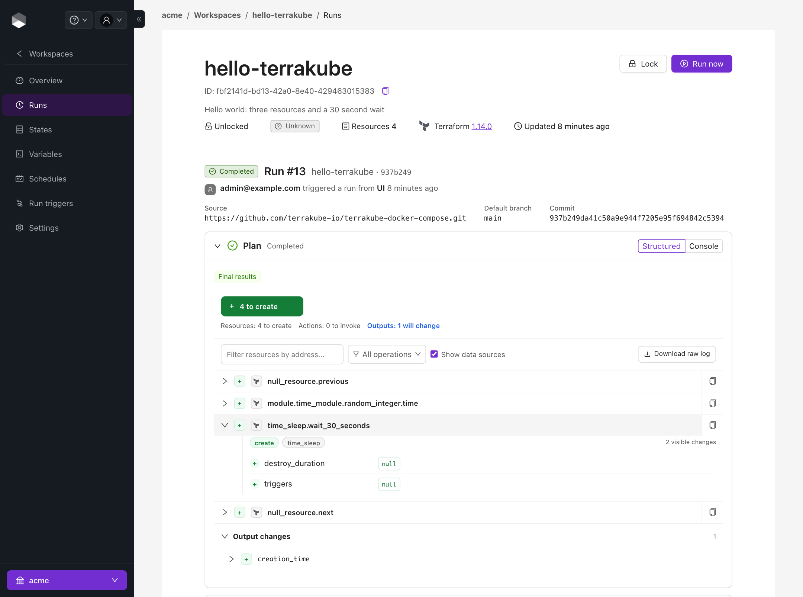
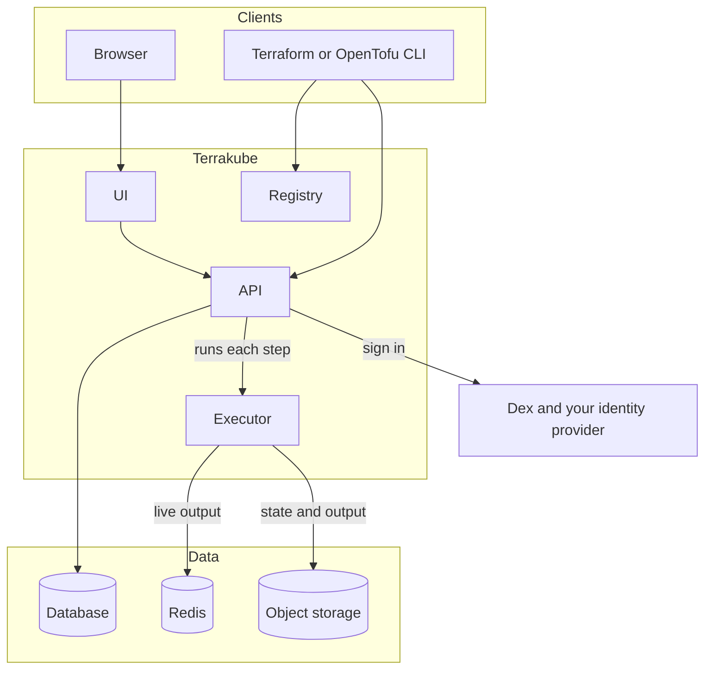

<div id="terrakube" align="center">
    <br />
    
    <h1>Terrakube</h1>
    <p>Open source IaC Automation and Collaboration Software.</p>
</div>

<div id="badges" align="center">

[](https://github.com/terrakube-io/terrakube/actions/workflows/pull_request.yml)
[](https://sonarcloud.io/dashboard?id=AzBuilder_azb-server)
[](https://sonarcloud.io/dashboard?id=AzBuilder_azb-server)
[](https://github.com/terrakube-io/terrakube/releases/latest)
[](https://hub.docker.com/r/azbuilder/api-server)
[](https://github.com/terrakube-io/terrakube/blob/main/LICENSE)
[](https://securityscorecards.dev/viewer/?uri=github.com/terrakube-io/terrakube)
[](https://docs.terrakube.io/)
[](https://join.slack.com/t/terrakubeworkspace/shared_invite/zt-2cx6yn95t-2CTBGvsQhBQJ5bfbG4peFg)

</div>

## Try it without installing anything

Open Terrakube in a GitHub Codespace to test it from your browser:

[](https://github.com/codespaces/new/terrakube-io/terrakube)

## Features

- **Organizations and Workspaces:** Use Organizations and Workspaces to manage your infrastructure in a structured and efficient way. Workspaces also support Tags, which let you group, organize, and filter your workspaces based on the tags you assign to them.



- **Private Registry:** Publish your Terraform Modules and Providers privately.



- **Version Control Integration:** Terrakube integrates with GitHub (Cloud and Enterprise), GitLab (EE and CE), Bitbucket and Azure DevOps to retrieve your terraform/opentofu code.



- **Terraform Workflow:** Terrakube allows you to run the Terraform / OpenTofu workflow from anywhere, anytime. You can perform actions such as terraform apply, terraform plan, and terraform destroy. You can also manage variables and access the Terraform state files.



- **Custom Workflows:** Enhance your IaC workflow with Infracost, or any other tool of your choice. You can use Terrakube extensions to integrate them seamlessly, or create your own custom integration using the Terrakube API. This way, you can automate compliance checks, cost estimates, security scans, and more for your Terraform projects.

- **Policy as Code:** Evaluate [OPA](https://www.openpolicyagent.org/) policies against every plan before it is applied. Policy sets run at an advisory, soft mandatory or hard mandatory level, and exemptions can be scoped to an organization, project or workspace. See [Policy Enforcement](https://docs.terrakube.io/user-guide/policy-enforcement-opa).

- **Access Control:** You can use [Dex](https://github.com/dexidp/dex) to authenticate in Terrakube with various identity providers, such as Azure Active Directory, Amazon Cognito, GitHub, SAML, and more. You can also leverage your existing groups to assign granular permissions to Workspaces, Modules, VCS, and other resources.

- **Remote Backend:** Terrakube supports both `remote backend` and `cloud` block so you can run your workflow directly from the Terraform / OpenTofu CLI.

- **Dynamic Credentials:** Give runs short-lived access to AWS, Azure, GCP or Vault through workload identity, so you do not store long-lived cloud keys in workspaces.

- **Flexible Executors:** Run on the built-in executor, on self-hosted agents, or as ephemeral Kubernetes jobs that exist only for the length of a run.

- **Drift Detection and Schedules:** Run plans on a schedule to catch drift, and chain workspaces with run triggers.

- **Pull Request and CI Integration:** Webhooks from GitHub, GitLab, Bitbucket and Azure DevOps trigger plans for your pull requests, and Terrakube posts the result back to the pull request on GitHub, GitLab and Bitbucket. You can also run Terrakube jobs from your pipelines with the [Terrakube GitHub Action](https://github.com/terrakube-io/terrakube-action-github).

- **Manage Terrakube as Code:** Use the [Terraform provider](https://registry.terraform.io/providers/terrakube-io/terrakube/latest), the Terrakube CLI or the API to configure organizations, workspaces and policies.

## Use it from the Terraform CLI

Point the `cloud` block at your Terrakube API and run Terraform as usual. The run executes in Terrakube and the output streams back to your terminal.

```hcl
terraform {
  cloud {
    hostname     = "terrakube-api.example.com"
    organization = "acme"

    workspaces {
      name = "hello-terrakube"
    }
  }
}
```

Run `terraform login terrakube-api.example.com` once, then `terraform plan` or `terraform apply`. More in [CLI-driven workflow](https://docs.terrakube.io/user-guide/workspaces/cli-driven-workflow).

## How it fits together



The executor writes the live output to Redis and the state and final output to object storage, and the API reads both back. Terrakube stores state and run output in Amazon S3 (or any S3-compatible service such as MinIO), Azure Blob Storage, Google Cloud Storage or local disk. The database is PostgreSQL or Azure SQL (H2 is available for local testing).

## Getting started

- [Install Terrakube using Helm](https://docs.terrakube.io/getting-started/deployment)
- [Install Terrakube using Docker Compose](https://docs.terrakube.io/getting-started/docker-compose)
- [Test Terrakube using minikube](https://docs.terrakube.io/getting-started/deployment/minikube-+-https)
- [Test Terrakube using Gitpod](https://docs.terrakube.io/getting-started/getting-started)
- [Develop Terrakube locally using Dev Containers](.devcontainer/README.md)

## Documentation

The user and administrator documentation is at [docs.terrakube.io](https://docs.terrakube.io/). Operational runbooks and reference pages that go with the code are in the [docs](docs/README.md) folder of this repository.

## Security

Please report vulnerabilities privately to security@terrakube.io. See [SECURITY.md](SECURITY.md) for what to include.

## Contributing

Terrakube welcomes any idea or feedback from the community. If you want to contribute to this project, please read our [Contribution Guide](CONTRIBUTING.md) for more details.

## Sponsors

| Sponsor  | Thanks |
| ------------- | ------------- |
| [ JetBrains](https://jb.gg/OpenSource)  | For providing with free licenses to their great tools.   |
| [ GitBook](https://www.gitbook.com/)   | For providing us with free OSS Plan. |
| [ Docker](https://www.docker.com/) | For providing us with free OSS Plan.|
| [ Tuta](https://tuta.com/) | For providing us with free email service.|

## Terraform BSL License

Hashicorp confirmed that Terrakube is compatible with the new Terraform BSL License, more information can be found in the following [discussion](https://github.com/orgs/terrakube-io/discussions/467).
